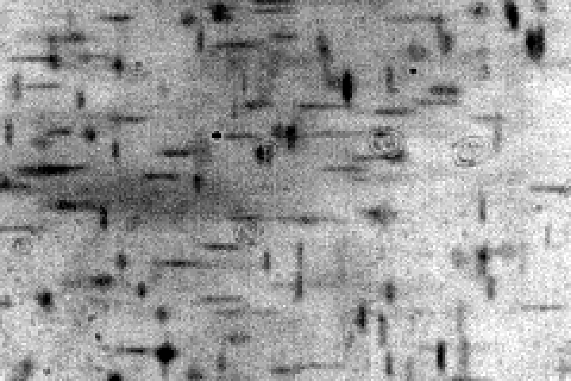

# Case: tracking tracers through the tube, run 20261007 (T0, Planes, T1) — plan

7 October 2026. **Status: done.** Approved for all phases (you, 7 Oct evening: "go on for all phases"); every phase
has run. The final report is `2026-10-07-report.md` (with the Phase C and lines reports, and the library report
`tests/cylinder_stb/2026-10-07-report.md`). Changes from this plan, all explained in the reports:
- S2 is fitted by background subtraction;
- S2b (the model against the Planes) and T1-e (a ghost control) were added;
- S3 uses a 1.5 px epipolar tolerance.

Your answers to the questions are in section 8.

You asked for a detailed plan to extend pyOpenLPT's tracking (STB) to tracers inside the water-filled tube, and to
process the new recordings in `X:\Shijie Zhong\Refraction\Raw\20261007`: `T0` for the camera calibration, `T1` for
tracer tracking. There is also a third folder, `Planes`, which this plan uses as well. Everything happens inside
pyOpenLPT:
- this case's code, tests and reports go in `pyOpenLPT/cases/cyl_20261007/`;
- the library tests go in `pyOpenLPT/tests/cylinder_stb/`;
- the results go in `X:\Shijie Zhong\Refraction\Processed\20261007\`, one subfolder per raw subfolder (`T0`, `Planes`, `T1`).

The plan follows from the suggestions of this morning (the pipeline through the tube) and from a first look at the
new data, which changes one part a lot: **the tracer images are short lines, not spots.**

## 1. The data

I looked at it read-only (scratch scripts, kept in `p0_evidence/`).

| item | value |
|---|---|
| cameras | the two Phantom VEO 710L of 6 Oct (serials 29199 = cam1, 23752 = cam2, from the `.chd` headers), 1280 × 800 px, 8-bit TIFF, 20 µm pixels, 180 mm macro lenses |
| T0, calibration | the hanging wand of 6 Oct (balls 3 and 4 mm, 10 mm apart, 2 mm rod), backlit. 15,001 frames per camera (`frame000000` … `frame015000`), 100 frames/s, 100 µs exposure |
| Planes | the dot board of 30 Sep (3 mm pitch, 1.5 mm dots), at three positions `0`, `1`, `2`, "far from cam1" (its `README.txt`); one frame per camera each. cam1 sees the board face-on (8 × 6 dots); cam2 sees it at a steep angle (about 15 × 7 dots), with the blur growing across the board and the board's edge in view |
| T1, tracers | 1,001 frames per camera (`frame000000` … `frame001000`), 4,000 frames/s, 100 µs (from cam2's header; **cam1's folder has no `.chd`**). Backlit: dark particles on a bright background, median grey level 107 (cam1) and 149 (cam2) |
| order | files written at 15:33 (T0), 15:44–15:47 (Planes) and 15:59 (T1) |

### What the tracer images look like

**Each particle images as a short horizontal or vertical line.** This is the tube's astigmatism, seen through a wide
aperture. The tube brings detail across its axis (horizontal in both cameras) into focus at a different depth from
detail along its axis.
- On T2's cameras, the tangential focus lies within −8…+7 mm of the particle and the sagittal focus 19–30 mm nearer
  the camera (`p0_evidence/probe_rig.py`).
- A particle at one focal depth therefore gives a horizontal line and at the other a vertical one. Between the two it
  gives a blob, and beyond them a longer line.

First numbers, from frame 0 with the background taken as the per-pixel 90th percentile of 26 frames and a 31 px
median high-pass (`p0_evidence/recon_t1.py`):

| | cam1 | cam2 |
|---|---|---|
| noise after background removal | 1.5 counts | 1.7 counts |
| objects above 4σ (overlapping ones merge) | 1,179 | 1,608 |
| horizontal lines (aspect ≥ 2) | 26 % | 27 % |
| vertical lines (aspect ≥ 2) | 30 % | 35 % |
| line cores above 4σ: horizontal length, median (90th percentile) | 9 px (18 px) | 9 px (18 px) |
| line cores above 4σ: vertical length, median (90th percentile) | 8 px (12 px) | 8 px (12 px) |
| thickness | about 3 px | about 3 px |
| shift between frames 0 and 4 (window correlation) | −2 px horizontal | −1 px horizontal |

The rest of the objects are blobs, crosses and merged pairs.
- **The thresholded cores are shorter than the lines.** By eye the horizontal lines reach 15–30 px. The long ones
  are faint, because each particle's shadow is spread over more pixels.
- **The background carries slowly varying dark clouds.**
- **Particles move only 0.25–0.5 px per frame.**

**What this means for the plan:**
- **The current tracer finder will split each line into several detections.** It finds local maxima and fits a
  3-point Gaussian. On synthetic stretched spots (σy 0.8 px), it split 17 % of the particles at σx 2.4 px and 56 % at
  3.2 px, and these lines are longer still. A detector for lines is needed (Phase 4).
- **The shape carries depth.** A line's orientation and length say where along the camera's ray the particle lies.
  With two cameras this is the main lever against ghost matches:
  - At about 1,500 objects per frame, a 2 px wide strip along a ~1,300 px epipolar line holds about 4 candidates.
  - Kept to the depth the shape allows (about ±3 mm of ~45 mm), it holds about 0.5.
  - This is an estimate, which Phase 5 measures.
- **Process every k-th frame**, with k ≈ 4–8, so that particles move 1–3 px per step. Phase 0 sets k.

## 2. What is already known about the pipeline through the tube

These were measured this morning on T2's cameras (`p0_evidence/`). Phase 0 repeats the ones that depend on the rig
with today's calibration.

| what | measured | consequence |
|---|---|---|
| cost of `project()` (PINCYL) | 175–193 µs per call against 0.33 µs for a pinhole (~550×); `classifyNear` takes 163 µs of it | Shake calls `project()` 50–75 times per particle per camera per frame. A Newton step started from the previous answer took 1.8 µs (median 2 iterations) → Phase 1 |
| images per camera | for air/acrylic/water, every camera sees each point exactly once inside r_c = n_air·R_outer/n_water = 75.6 mm (74.0 mm at C_z = 0.3; near-branch uniqueness and Theorem `thm:farmono`). The shared volume of T2's cameras reached r ≤ 30 mm; a census of 3,627 points found no doubles and no shadow | your no-image / multi-image rule is not exercised by this rig. It is still built for general use, at lower priority (Phase 2) |
| epipolar lines | true matches lie 0.54 px (median) and 1.05 px (max) from StereoMatch's straight line, cam1 → cam2. The default `tol_2d_px` is 1.0 | image lines become polylines (Phase 3) |
| view box reaching the wall | `project()` of a line-of-sight end outside the water fails, so the line is silently dropped | clip lines of sight to the water (Phase 3) |
| camFile tolerance | the wand fit writes `Projection Tolerance` 1e-12; 3 of 40,000 central projections then return no image (points in each camera's near/far junction plane); at 1e-9 none fail, with identical pixels | tracking camFiles get 1e-9 (C4) |
| Shake's ROI | a square of `radius_px` | lines need ROIs shaped by the OTF (Phase 2) |
| OTF | (a, b, c, α) per grid cell can describe elongated spots, but the initial estimate (alpha = 0) and VSC's fit use square windows | fill it from a shape model (Phase 4) |
| VSC | camera refinement handles PINHOLE only and skips PINCYL | left off for these cameras; no change planned |
| finder on stretched spots | particles split into ≥ 2 detections: 2 / 17 / 56 % at σx 1.6 / 2.4 / 3.2 px (σy 0.8 px); x RMS 0.11 / 0.30 / 0.50 px against 0.02 px for round spots; no bias | line detector (Phase 4) |

## 3. Overview and order

| phase | what | where the code goes |
|---|---|---|
| 0 | survey of T0, Planes, T1 (read-only) | case `tests/` |
| C | calibration: T0's wand, checked and if needed pinned by the Planes | case code; `cylinder_wand` gets one option only if C3 is needed |
| 1 | fast projection for tracking (warm-started Newton) | C++: `Camera`, `RefractionCurvedCamera`, `Object3D` |
| 2 | per-camera visibility (your rule), Shake consistency, ROIs from the OTF | C++: `Shake`, `ObjectInfo` |
| 3 | curved epipolar lines, clipped to the water | C++: `StereoMatch` |
| 4 | line images: preprocessing, line detector, shape model, depth cue, C++ port | Python prototype in the case, then C++: `ObjectFinder`, `OTF`, `Config`, `StereoMatch` |
| 5 | synthetic end-to-end validation (ablation R0–R3) | `tests/cylinder_stb/` |
| 6 | tracking T1 | case code; results on X: |
| 7 | report | case and `tests/cylinder_stb/` |

**Approval in three stages.** Each stage ends with a short report, and the next starts on your go-ahead.
- **Stage A, first results:** Phase 0, Phase C, Phase 1, and **A-run**: a first T1 run with today's code on about 100
  frames, preprocessed with the existing module (invert and mean background). It shows the failure modes on real data
  before anything is built for them.
- **Stage B, the lines:** Phase 3, Phase 4 steps L1–L2 (preprocessing, and a detector prototype on T1), and Phase 2's
  ROI part.
- **Stage C, the shape model and end to end:** Phase 4 steps L3–L6, the rest of Phase 2, Phase 5, Phase 6 and the
  report.

## 4. Phases

### Phase 0 — survey (read-only)

| step | what | used for |
|---|---|---|
| P0a | files and headers: serials, frame rates, exposures, frame counts, file times; cam1's missing T1 header | facts in the report |
| P0b | T1 images, every 50th frame of both cameras: background (per-pixel 90th percentile), noise, objects per frame, and their shapes (horizontal / vertical / round, lengths, thickness, contrast against length) | detector settings (L1, L2), synthetic case (Phase 5) |
| P0c | T1 motion: window cross-correlation between frames k = 1, 2, 4, 8, 16 apart, both cameras | frame step (aim: 1–3 px per step) |
| P0d | T0 wand survey as T2's `p0_survey`: light along the recording, rod-opening scan, frames usable in both cameras | settings for C1 |
| P0e | Planes: dots found per camera, blur of the dots across the board in cam2 | C2, L3 |

### Phase C — calibration of T0, checked with the Planes

The wand part reuses the 6 Oct T2 case's code (`cases/cyl_20261006_T2_wand`, copied with the paths changed). The
board part reuses the 30 Sep case's (`cases/cyl_20260930_T0_cam1`: `dots.py`, `grid_index.py`, `cylfit.py`).

| step / test | what | judged by |
|---|---|---|
| C1 wand calibration | T2's settings: ellipse detection, Dark on Bright, radius 40–120 px, rod opening 95 px, rod mask 50 px; k1 off; noise weights per camera; thorough start search. All 15,001 frames (about 30 min over the network share) | it converges; residual maps show no pattern above ~0.1 px; every check on the results page is explained |
| C1-T repeatability | halves and quarters (as T2's T3); held-out wand lengths (as D8) | f spread as on 6 Oct (cam1 36,500–40,900 px) means f is not determined → C3 |
| C1-X did the rig move? | 6 Oct T2's cameras on today's wand frames (as X1) | reported |
| C1-D sync | the two cameras' time offset (as D1) | below 0.01 frame |
| C2a board check | the Planes' dots in both cameras (cam2's oblique view needs the detector adapted), indexed by the board's fiducial L and triangulated with C1's cameras | pitch 3 mm within ~0.1 %; each plane flat; plane-to-plane steps match the stage |
| C2b f from the board | per camera, the three planes fitted as on 30 Sep (one pose per plane, tied by the stage's translation) | f and distance with error bars, against C1's f/distance line. cam2's oblique view constrains f much better than cam1's three face-on planes |
| C3 hold f (only if C1-T shows f undetermined) | a `fix_f` option in `cylinder_wand` (the Layout leaves f out for the chosen cameras; default unchanged); synthetic tests on the campaign's harness (truth recovered with f held; bias with f 1 % off); T0 refitted with C2b's f | synthetic: truth within σ; real: C2a passes, and the halves and quarters agree |
| C4 tracking camFiles | copies of the delivered camFiles with `Projection Tolerance` 1e-9 | same pixels as the 1e-12 files wherever both succeed |

### Phase 1 — fast projection for tracking

**Changes.** All of them are automatic for curved-port cameras only; nothing changes for the others.
- **Hints:** each 3D object keeps, per camera, the invariants of its last image (Λ, C_z, near/far), and they are
  copied with the object (prediction, Shake's trial positions). They cannot live on the 2D objects, because
  `projectObject2D` recreates those on every call.
- **`Camera::projectWithHint`** (the name is to be settled):
  - Single-valued models call `project()` and ignore the hint.
  - The curved port runs the existing Newton solvers (`solveCylinder`, `solveFar`) from the hint. It accepts the
    result when the solve converges inside the domain and the point lies inside r_c(C_z), where it is the only image.
  - Otherwise it runs today's `projectAll()` and the primary-image rule, then refreshes the hint.
- **Hints for new particles:** a particle triangulated by StereoMatch gets each camera's hint from the line of sight
  of the detection it was built from (that ray's own invariants). The near/far label comes from where the point lies
  on the ray.
- **`Object3D::projectObject2D`** uses the hints.

| test | what | judged by |
|---|---|---|
| F1 agreement | 200,000 random points in the shared volume, with hints from points moved by 1 µm–0.5 mm | pixels within 1e-6 px of `project()`; the same failures; fallback rate reported |
| F2 hints from lines of sight | two-camera correspondences, triangulated, hinted from their rays | as F1 |
| F3 near/far junction | points moving through each camera's junction plane | identical pixels along the path; fallbacks only there |
| F4 speed | cost per call, and Shake-like sequences of calls | median ≤ 3 µs (today 180 µs) |
| F5 Shake and STB | a synthetic PINCYL case, slow path against fast path | the same 3D positions within 1e-9 mm and the same tracks |
| F6 regression | pinhole and plate STB 50-frame runs with the `stb_improve` harness (exe and module), then pytest | bit-identical; pytest 254 passed plus the 4 old failures |

### Phase 2 — per-camera visibility, Shake consistency, ROIs from the OTF

**Changes:**
- **Status per camera:** none, one or ambiguous, by your rule. A camera is kept when exactly one image falls on its
  sensor, enlarged by the spot's half-size. A camera is also ambiguous when two images lie within about two spot sizes
  of each other anywhere: that is a merged pair next to a fold. Inside r_c the census is skipped. `isReconstructable`
  uses the statuses.
- **Shake:** each particle's camera set is fixed at the start of each shake. A trial position with no image in a
  chosen camera costs an empty prediction instead of dropping that camera. Pinhole projections never fail, so their
  results do not change.
- **Residual image:** for an ambiguous camera, all of the particle's images are subtracted (or masked), so that IPR
  does not detect them again.
- **ROIs from the OTF:** half-widths of about 3σ along each axis, rotated by α. They are used for the shake window,
  the score and the residual subtraction. This is opt-in through a new config.json key (default: today's square), so
  existing cases keep their results.

| test | what | judged by |
|---|---|---|
| V1 statuses | a synthetic wide-view rig that sees the whole tube, so the shadow and double bands are in view; 50,000 points | statuses agree with `projectAll()`'s census; points inside r_c never need the census |
| V2 the shadow edge | a particle moving into one camera's shadow during a shake | the cost stays continuous and the shake converges |
| V3 ROI | synthetic line images 5–30 px long | ≥ 98 % of each particle's signal removed from the residual (today's square ROI leaves most of a long line) |
| V4 regression | as F6, with the new key off | bit-identical |

### Phase 3 — curved epipolar lines

**Changes.** For curved-port cameras only:
- **Clipping:** each line of sight is clipped to the view box and to the water (r below the inner radius).
- **Polylines:** the image line in a curved-port camera becomes a polyline. Points along the clipped line of sight are
  projected with hints and subdivided until the chord stays within 0.05 px of the curve.
- **StereoMatch:**
  - `IDMap`'s row spans come from the union of the segments' strips.
  - The exact test becomes the distance to the polyline, and `checkBackProjection` uses it too.
  - Straight lines (pinhole and plate) are unchanged.
- **Depth hook:** Phase 4 can cut the line of sight to the depth range a detection's shape allows.

| test | what | judged by |
|---|---|---|
| E1 coverage | 50,000 true correspondences on today's calibrated rig | polylines: ≥ 99.9 % inside tolerance 0.25 px. The straight line is shown for comparison (on T2: 0.54 px median, 1.05 px max) |
| E2 candidate load | candidates per line at T1's density | fewer than with straight lines at equal coverage |
| E3 large view box | a box that reaches past the tube's wall | lines are built (today they are dropped) |
| E4 regression and cost | as F6; time spent building lines | bit-identical; time per frame reported |

### Phase 4 — line images: preprocessing, detector, shape model, depth cue

| step / test | what | judged by |
|---|---|---|
| L1 preprocessing | for shadowgraphs: • background = per-pixel 90th percentile over the recording • signal = background − image • high-pass = minus a 31 px median of the signal, which removes the dark clouds • gain so that the noise (~1.6 counts) uses 8 bits well A case script first; an option in `modules/image_preprocessing` later if you want it | on synthetic images, the particles' contrast is kept; on T1, the background is flat; noise in counts reported |
| L2 detector (Python prototype) | matched filters for horizontal and vertical segments (5–35 px) and for round spots (σ 1–3 px); non-maximum suppression across scales; then a 2-D fit of a segment ⊗ Gaussian model, giving centre (u, v), lengths, amplitude and fit quality | on synthetic lines with T1's lengths, contrast, noise and density: recall ≥ 95 % at SNR ≥ 5, duplicates ≤ 1 %, centre error ≤ 0.1 px across the line and ≤ 0.3 px along it, all against today's finder; on T1: overlays and counts |
| L3 shape model | per camera, L_h(X) = A·f·\|1/z_tan(X) − 1/z_f\| and L_v(X) = A·f·\|1/z_sag(X) − 1/z_f\|, plus a base width σ0: • z_tan and z_sag come from the PINCYL model (the parallax of a displaced pinhole, as in this morning's probe) • each camera has three parameters (z_f, A, σ0), fitted from the Planes (dot-edge blur at known depths; cam2 sees a range of depths) and from conservatively matched T1 tracers • an amplitude model (contrast against line length) alongside The model fills the OTF table (b, c per cell) on a fine grid | predicted against measured lengths on held-out tracers: RMS ≤ 1.5 px (proposed), with no trend with depth |
| L4 depth cue | each detection's shape gives the depth interval along its ray where the model agrees; Phase 3 cuts the polyline to it; every candidate match is finally checked for shape in both cameras | synthetic: ghost candidates per true match cut several-fold, and ≤ 1 % of true matches lost |
| L5 C++ port | `tracer.detector: "lines"` with its parameters in config.json; `Tracer2D` gets the shape fields (and the bindings); `tracer.otf_file` loads the model's OTF instead of the uniform estimate; the depth cue is behind a key. Defaults stay as today | the C++ detector equals the Python one on the same images (same detections, centres within 1e-3 px); defaults bit-identical (F6) |
| L6 SymPy checks | the parallax depth, the astigmatic blur and the moment-matched widths, with the `sympy-check` method, in `tests/cylinder_stb/sympy_checks.py` | PROVED wherever SymPy can express the step |

### Phase 5 — synthetic end-to-end validation

- **Generator:**
  - today's calibrated rig, with particles at T1's density in the shared volume;
  - a smooth swirling flow, scaled to T1's displacement per step;
  - shadowgraph line images rendered from the shape model as uniform ellipses ⊗ Gaussian, so that the Gaussian OTF
    is tested and not assumed;
  - T1's contrast and noise, 8-bit; the truth is saved.
- **Runs (ablation):**
  - R0: today's code on the preprocessed images;
  - R1: R0 plus Phase 1;
  - R2: R1 plus Phases 2 and 3;
  - R3: R2 plus Phase 4.
- **Metrics:**
  - per frame: particles reconstructed, matched to the truth, and ghosts; position error in x, y and z;
  - per run: track recall, purity and mean length, and time per frame.
- **Pass criteria:**
  - R1 equals R0;
  - R3 has fewer ghosts and a higher recall than R0;
  - the numeric targets are fixed with you after R0.

### Phase 6 — tracking T1

| step / test | what | judged by |
|---|---|---|
| S1 preprocessing | L1 on all 1,001 frames, with the frame step from P0c | — |
| S2 shape model for T1 | A refitted, since the aperture may differ from the Planes' | as L3 |
| S3 tracking | the final settings on all frames; today's code (R0) on a chunk for comparison | — |
| T1-a residuals | reprojection RMS per camera; mean epipolar residual | mean ≈ 0 (otherwise the cameras moved after T0) |
| T1-b sync | epipolar residual against image velocity | no correlation (otherwise there is a time offset; cam1's header is missing) |
| T1-c shapes | measured against predicted line lengths of tracked particles | as L3 |
| T1-d the flow | track counts and lengths, velocity statistics, smoothness; tracks drawn over a few frames; image-plane cross-correlation as a cross-check | plausible, and consistent with the images |

### Phase 7 — report

- **Case report:** `cases/cyl_20261007/<date>-report.md`.
- **Library report:** `tests/cylinder_stb/<date>-report.md`.
- **READMEs** in both folders and on X:.
- **Also recorded:** what changed in the library, and how to rerun each step.

## 5. Outputs

**`X:\Shijie Zhong\Refraction\Processed\20261007\`:**

| folder | contents |
|---|---|
| `T0\` | `camFile\cam1.txt`, `cam2.txt` (as fitted), `camFile_track\` (the same with `Projection Tolerance` 1e-9), `calibration_report.html`, `calibration_result.json`, `calibration_report.txt`, `wand_points.csv`, `detection\`, `README.md` |
| `Planes\` | the dots found, the board check (pitch, flatness, steps), f per camera, `README.md` |
| `T1\` | `images\` (preprocessed), the STB `config.json`, the tracks (OpenLPT's files and a CSV), a results page, `README.md` |

**pyOpenLPT:**
- `cases/cyl_20261007/`:
  - this plan;
  - `config.json` (every number of the case) and the case code;
  - `tests/` with their outputs beside them;
  - `p0_evidence/` (this morning's probes);
  - reports and a README.
- `tests/cylinder_stb/` (library tests with their outputs, and a report), `tests/test_cylinder_stb.py` (pytest
  regression), and `.gitignore` negations for both (`tests/**` is ignored).
- **Library:**
  - C++ in `src/`, `inc/`, `src/pybind_OpenLPT/`, as listed per phase;
  - `cylinder_wand.py` only if C3 is needed.

## 6. What stays unchanged

- **Existing cases keep their results.** Every new behaviour is either automatic for curved-port cameras only (Phases
  1, 3, and 2's statuses) or opt-in through new config.json keys (OTF-shaped ROIs, the line detector, the OTF file,
  the depth cue). Pinhole and plate runs stay bit-identical. After each phase this is checked by 50-frame STB runs with
  the `stb_improve` harness (exe and module) and by the pytest baseline (254 passed plus the 4 old failures).
- **Builds:**
  - each phase builds into `build-stb/<name>/` (the harness's `build_variant.py`);
  - your GUI's build (`build/Release`, `build-py/Release`) is rebuilt only at the end, with your OK;
  - case runs import a frozen copy of the module.
- No commits; you commit.

## 7. Risks

1. **f undetermined again,** as for both runs of 6 Oct. C2b and C3 address it, but C2b needs the Planes' stage steps
   (question 1). With three face-on planes, cam1's f from the board may be weak; cam2's oblique view is the stronger
   constraint.
2. **Heavy overlap.** There are 1,200–1,600 objects per frame, with lines up to ~30 px, and a line's ROI is ~20 times
   a round spot's. This hurts detection recall and the cost of Shake. Mitigations:
   - matched filters with 2-D fits;
   - ROIs of 2.5–3σ;
   - the frame step.
3. **Two cameras.** Without the depth cue, ghosts will probably dominate. With it, some still survive; STB's temporal
   consistency removes most of them. Phase 5 measures how many are left.
4. **The shape model may not fit everywhere.** Possible causes:
   - aberrations beyond astigmatism, near the tube's edges;
   - the particles' own size;
   - the cross-shaped images seen in T1.

   The fit residuals are reported. The fallback is a data-driven OTF per cell from tracked particles (VSC's
   `runOTF` with OTF-shaped windows).
5. **The cameras may have moved between T0 and T1,** as they moved by ~1 px between 6 Oct's runs. T1's mean epipolar
   residual shows it. A PINCYL pose refinement from tracers is not in this plan.
6. **The network share is slow** (~22 MB/s). T0's detection takes ~30 min, and T1 is ~2 GB per pass. During
   development a local copy of T1's preprocessed images is kept in a git-ignored `data/` folder.

## 8. Decisions and questions

**Decisions, with my recommendation first:**

| # | decision | recommendation | alternative |
|---|---|---|---|
| D1 | folder layout | this case for the data; `tests/cylinder_stb/` for the library's tests; pytest regression in `tests/` | everything in this case |
| D2 | detector | matched-filter bank plus 2-D segment fits | threshold, connected components and moments (simpler, but merges crossing lines) |
| D3 | shape (PSF) model | physical: three parameters per camera, valid everywhere, also gives the depth cue | an OTF grid fitted from data alone (needs many particles per cell) |
| D4 | depth cue in matching | yes (two cameras) | later |
| D5 | your no-image / multi-image rule | build the general version (Phase 2) after T1's first results, since this rig does not need it | first |
| D6 | hold f in `cylinder_wand` | only if C1 shows f undetermined | a joint wand + board fit (more work) |
| D7 | GUI | not in this plan (config.json keys and scripts); later | now |
| D8 | builds | variants during the work; your GUI build at the end with your OK | — |

**Questions:**
1. **Planes:** how far did the board move between `0`, `1` and `2` (how many 0.1 in stage steps)? Was the stage's
   axis along cam1's view, with the board facing cam1? (Needed for C2b.)
2. **T1:** cam1 has no `.chd` header. Were its settings the same as cam2's (4,000 frames/s, 100 µs)? Did both cameras
   run on one trigger?
3. **Between T0, the Planes and T1, did you change the focus or the aperture?** A focus change would invalidate T0's
   calibration for T1. An aperture change only changes the line lengths, which S2 refits.
4. **The tracers:** material and diameter, how the flow was driven and roughly how fast. (For the synthetic case and
   the sanity checks.)
5. **Which stage to start?** I propose Stage A: Phase 0, the calibration, the fast projection and the first T1 run
   with today's code.

**Your answers (7 Oct evening):**
1. The board moved about one full turn of the stage's screw between positions, about 0.125 in (3.175 mm); the
   folder's README says the positions go away from cam1. C2b takes 3.175 mm as nominal and C2a measures the steps.
2. Both cameras were synchronised (one trigger), at the same settings: T1 is 4,000 frames/s with 100 µs for both.
3. Focus and aperture were not changed: T0, the Planes and T1 share one calibration, and S2's refit of A is only a
   check.
4. The tracers are 60 µm polyamide particles.
5. All phases.
