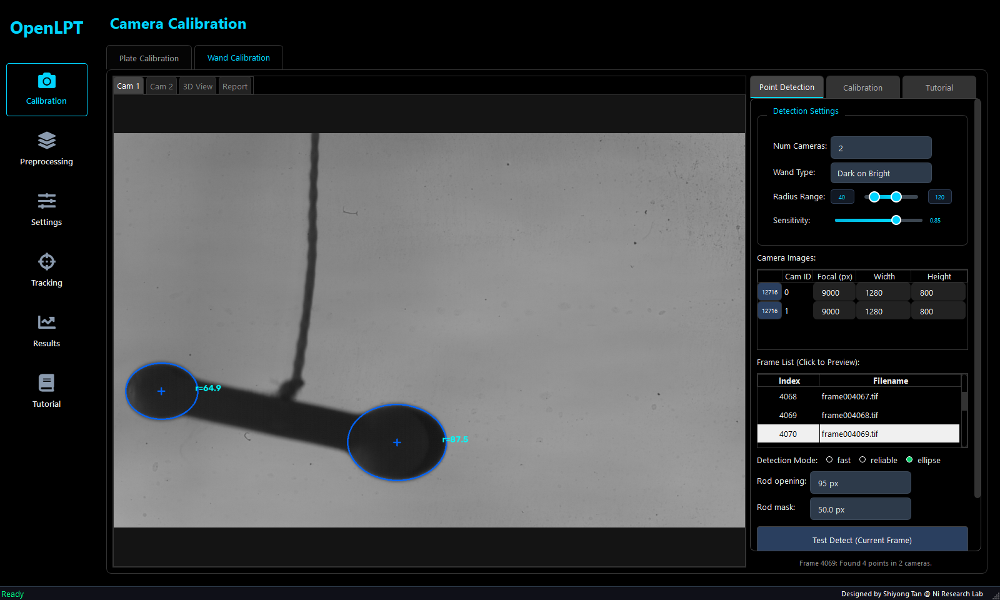
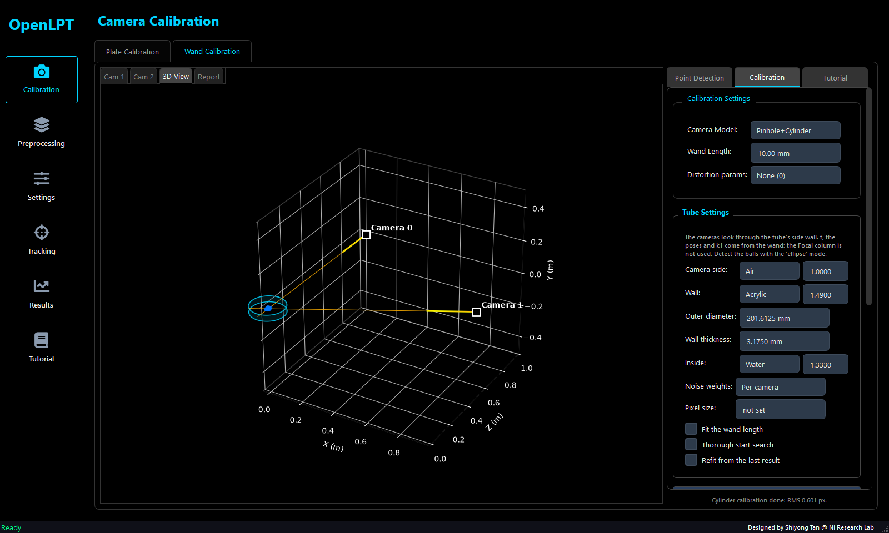
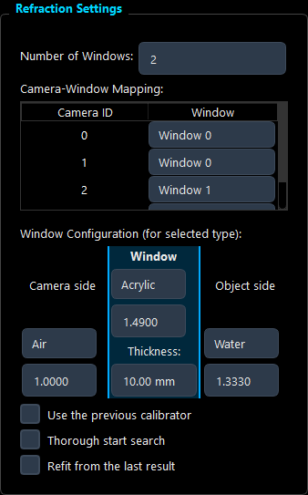
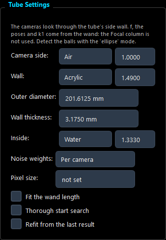
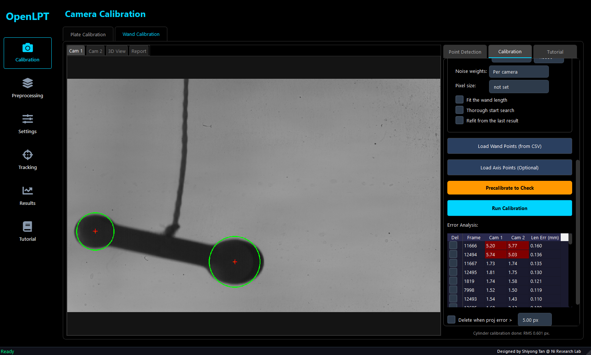
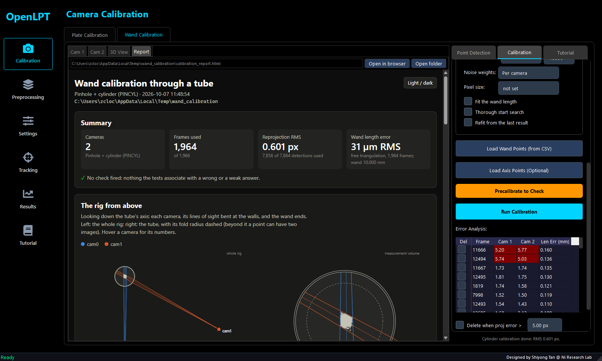

<!-- Maintainers: edit this file, then `python make_user_guide.py html` rebuilds WAND_CALIBRATION_USER_GUIDE.html
     (the page the GUI opens; needs pandoc), and `python make_user_guide.py shots` retakes the guide_*.png screenshots
     from the real GUI. -->

# Wand Calibration User Guide

A wand calibration finds every camera's position, orientation and focal length (and, if asked, its lens distortion)
from images of a **wand** moved through the measurement volume: two balls of different sizes, a known distance apart.
Behind windows or a tube it also accounts for the refraction. The result is one camera file per camera
(`camFile/cam<id>.txt`), which tracking uses.

In the GUI: **Calibration** (left bar) → **Wand Calibration** tab.
- **Right side, three sub-tabs:** **Point Detection** (find the balls in every image), **Calibration** (fit the
  cameras), **Tutorial** (opens this guide).
- **Left side:** **Cam 1 … Cam N** (each camera's images), **3D View** (the fitted rig) and **Report** (the results
  page of the last calibration).

**The steps:**
1. Record the wand ([section 1](#1-recording-the-wand)).
2. Choose the camera model that matches your setup ([section 2](#2-choosing-the-camera-model)).
3. Detect the balls in every frame ([section 3](#3-point-detection)).
4. Optionally, define the world axes with an axis target ([section 4](#4-axis-points-optional-pinhole-model-only)).
5. Run the calibration ([section 5](#5-calibration)).
6. Check the result ([section 6](#6-checking-the-result)). Then use the camera files for tracking.

**Contents:**
[1. Recording the wand](#1-recording-the-wand) ·
[2. Choosing the camera model](#2-choosing-the-camera-model) ·
[3. Point detection](#3-point-detection) ·
[4. Axis points](#4-axis-points-optional-pinhole-model-only) ·
[5. Calibration](#5-calibration) ·
[6. Checking the result](#6-checking-the-result) ·
[7. Troubleshooting](#7-troubleshooting) ·
[8. Known issues](#8-known-issues-october-2026) ·
[9. Further reading](#9-further-reading)

---

## 1. Recording the wand

  

**The wand**
- **Two balls of clearly different sizes.** The GUI tells the balls apart by their image size: the small one is ball
  A, the large one ball B. Balls of about the same size cannot be paired.
- **A known length.** Measure the distance between the two ball centres as accurately as you can: it sets the scale of
  the whole calibration.
- **A thin rod.** The detector removes the rod before it separates the balls, which works only when the rod's image is
  clearly narrower than the small ball's. A thick rod also biases the ball centres. On the October 2026 tube
  recordings a 2 mm rod, about 75 % of the small ball's height in the image, limited the precision.

**The images**
- **Dark balls on a bright background** (backlight), or bright balls on a dark background: set the **Wand Type** to
  match ([3.2](#32-the-settings)).
- **Every camera must see both balls, apart, in as many frames as possible.** A frame is used only when every camera
  sees both. When the wand points along a camera's line of sight the balls overlap, and that frame is dropped.
- **Cover the whole measurement volume:** all positions, also towards and away from the cameras (depth), and many
  orientations of the wand.
- **No motion blur:** move the wand slowly enough for the exposure time.
- **Several hundred to a few thousand usable frames.** The tube and window models need at least 12; their reports warn
  below 200 (tube) or 300 (windows).
- **Synchronized cameras, one folder per camera, the same number of images in each.** The GUI pairs the cameras'
  images by their position in each folder's sorted file list, sorted as text: use zero-padded numbers
  (`frame000001.tif`, not `frame1.tif`).

**The rig**
- **Keep the cameras' viewing directions out of one plane.** Non-coplanar views make stereo matching and 3D
  reconstruction much more reliable. If the cameras must be nearly coplanar, keep at least about 5° between them.
- **Record the wand right before or after the experiment, without touching the cameras in between.** A calibration
  holds only while nothing moves: between two recordings an hour apart on 6 October 2026, the cameras moved by about
  1 px.
- **Long lenses looking at a small volume** (focal lengths of tens of thousands of pixels) see almost no perspective.
  The wand alone then cannot separate the focal length from the camera's distance; see
  [section 6.4](#64-is-the-calibration-good).

---

## 2. Choosing the camera model

| Your setup | Camera Model | What calibrates the cameras | Detection Mode |
|---|---|---|---|
| The cameras look through air, or through a flat window almost head-on | **Pinhole** | OpenLPT's wand bundle adjustment. Uses your Focal (px) values as its start. | fast or reliable |
| The cameras look through flat windows (tank or channel walls) at an angle; one or more windows | **Pinhole+Refraction** | **plate_wand** (since October 2026): every camera's pose, f and k1, and every window's plane, from the wand alone; no start values needed. The previous calibrator remains available as an option. | reliable (or fast) |
| The cameras look through the side wall of a water-filled tube | **Pinhole+Cylinder** | **cylinder_wand** (since October 2026): every camera's pose, f and k1 from the wand, with the tube's diameter, wall and refractive indices given. | **ellipse** |

> [!NOTE]
> The **Plate Calibration** tab (a dot target) is a separate calibration with its own models; this guide covers the
> wand tab only.

---

## 3. Point detection

*The Point Detection sub-tab. Here the "ellipse" mode is set for balls seen through a tube, and Test Detect has fitted
an ellipse to each ball of frame 4069.*

### 3.1 Steps

1. **Set Num Cameras.** Changing it later keeps the cameras that remain (their folders, Focal, Width, Height and
   window); a camera added starts empty.
2. **Load each camera's folder:** click the camera's **Load** button in the Camera Images table.
   - The button then shows the number of images.
   - Width and Height are filled in from the first image: check them.
3. **Choose the Wand Type, the Detection Mode** (and, for "ellipse", the Rod opening and Rod mask) **and the Radius
   Range** (sections [3.2](#32-the-settings) to [3.4](#34-setting-rod-opening-and-rod-mask-ellipse-mode)).
   Cameras that see the balls at different sizes (another lens, distance, binning or crop) get their own values with
   **Different settings for each camera**.
4. **Test on single frames.** Click a frame in the Frame List, then **Test Detect (Current Frame)**. Look at every
   Cam tab: each ball should carry exactly one circle (or ellipse).
   - Try several frames: the wand tilted, near the image edges, far and near.
   - Adjust the settings until it is right everywhere.
   - Test Detect stores nothing.
5. **Click Process All Frames / Resume.**
   - **Choose the file** for the results (`wand_points.csv`). It is also the autosave. Choosing an existing file
     offers to **resume** it.
   - **The detection record** goes beside it: `wand_points_detection.json`. It holds how the points were found: the
     mode, the Wand Type, and each camera's settings (as its detector got them) and images.
     - A resume adds an entry to it, and Export Data copies it beside the exported file.
     - **Load Wand Points** reads it back, and the results page lists it in its settings table. For reproduction,
       keep it with the points.
   - **The progress dialog** has **Pause** and **Stop**.
     - **Pause** halts the detection once the images already started are done, and frees the processors; **Resume**
       (the same button) goes on.
     - **Stop** saves what was detected; Process All Frames / Resume with the same file finishes it later.
   - **At the end** the status line says how many frames were paired (both balls found in every camera). The GUI
     then offers to export the points; the autosave file already holds the same data.
6. **Check the Frame List.** Frames that were detected but not paired are red and struck through. Clicking a frame
   shows its raw detections (blue), the small ball (green) and the large ball (dark green).

### 3.2 The settings

| Setting | Default | What it is and how to set it |
|---|---|---|
| **Num Cameras** | 4 | The number of cameras (1–16). Changing it keeps the cameras that remain (their folders, Focal, Width, Height and window); a camera added starts empty. Every camera row needs its images: a camera without images pairs no frame. |
| **Wand Type** | Dark on Bright | Dark balls on a bright background (backlight), or bright balls on a dark background: choose the one that matches the images, and check it with Test Detect. |
| **Radius Range** | 20–200 px | The balls' image radii, in pixels (the first camera's pixels when the table's Pixel column is set): set the minimum a little below the small ball's radius and the maximum a little above the large ball's. After a folder is loaded the maximum is limited to a quarter of the image's shorter side. In the ellipse mode it also sizes the background window (2.5 × the maximum, at least 101 px), which must be wider than a ball. Too small a maximum loses frames; the centres hardly move (0.01–0.04 px on a tube recording). |
| **Sensitivity** | 0.85 | The C++ circle finder's sensitivity (0.50–1.00), used by "reliable", by "fast" when its own search finds fewer than two circles, and by the axis-point detection. Not used by "ellipse" (greyed there, unless the Axis direction is Custom). Raise it when balls are missed, lower it when noise is found as circles. |
| **Load** (camera table) | – | Loads all `.png .jpg .bmp .tif .tiff .jpeg` images of a folder, sorted by name. When every camera's folder holds a Phantom header (`.chd`) and the cameras saved different ranges of images, the lists are cut to the images every camera saved, so that the i-th frames are simultaneous; the status line says how many were dropped. |
| **Cam ID** | 0, 1, … | The camera's number in the files (`cam0.txt`, CSV column Camera). The left tabs count from 1: Cam 1 is Cam ID 0. |
| **Focal (px)** | 9000 | The focal length in pixels (lens focal length in mm divided by the pixel size in mm). **Only a start value, and only for the Pinhole model and the previous refraction calibrator**: plate_wand and the tube model find f from the wand and ignore it (the column is greyed for "Pinhole+Cylinder"). |
| **Width, Height** | 1280, 800 | Each camera's image size in pixels (the cameras may differ), filled in from the first image of its folder. After loading points from a CSV file, set them by hand. The tube and window models put the principal point at the image centre; the Pinhole model starts it there. |
| **Pixel (µm)** | empty | The sensor's pixel size, for cameras whose pixels differ (e.g. Phantom VEO 710L 20 µm and v2640 13.5 µm). Set it for every camera: the Radius Range, Rod opening and Rod mask are then in the first camera's pixels, and a camera with pixels p gets them multiplied by p₁ / p (Test Detect and Process Frames alike). This holds while the settings are shared: with **Different settings for each camera** ticked, each camera's own values are used as they are. The results page prints each camera's f in mm with it. Empty: not used, and the detection runs as before. |
| **Frame List** | – | All frames, numbered from 1. Click to preview; the selected frame is the one Test Detect uses. |
| **Detection Mode** | fast | How each ball's centre is found: see [3.3](#33-choosing-the-detection-mode). |
| **Rod opening** | 25 px | Ellipse mode only. Removes the rod before the balls are separated: a little **wider than the rod's image**, narrower than the small ball's. 0: none. See [3.4](#34-setting-rod-opening-and-rod-mask-ellipse-mode). |
| **Rod mask** | 18.0 px | Ellipse mode only. Edge points within this distance of the line joining the balls, on the side facing the other ball, are left out of the ellipse fit (the rod pulls them): about the rod's half-width plus twice its edge blur. 0: none. |
| **Different settings for each camera** | off | For cameras that see the balls at different sizes: another lens, focal length, distance, binning or crop. Ticked, a table gives each camera its own **R min** and **R max** (its Radius Range), **Sens.** (shown where the Sensitivity is used: not in the ellipse mode unless the Axis direction is Custom), **Opening** and **Mask** (ellipse mode only), all in that camera's own pixels; the shared settings above are faded and not used. Ticking fills the rows from the shared settings (times the Pixel factor when it is set), so nothing changes until a row is edited. Tune each camera with Test Detect and look at its Cam tab. Unticked: the shared settings again (the rows are kept). A row whose R min is not below its R max stops the detection with a warning. |
| **Axis direction** | Default | At the bottom: Custom opens the axis-point tools ([section 4](#4-axis-points-optional-pinhole-model-only)). |

The ellipse mode also drops a pair whose two ellipses come within 3 px of each other (fixed, not shown).

### 3.3 Choosing the detection mode

| Mode | How it finds a ball | Use it for | Settings it uses |
|---|---|---|---|
| **fast** | Otsu threshold, then a circle fitted to the edge around each blob (RANSAC, with fixed random draws: an image always gives the same points). Keeps the two best circles; falls back to "reliable" when it finds fewer than two. | Clear images without refraction or distortion: cameras in air. Not through a tube: there it can even keep another blob than the ball. | Radius Range (Sensitivity in the fallback) |
| **reliable** | OpenLPT's C++ circle finder; returns every circle it finds. Slower. | Cameras behind flat windows; images where "fast" misses balls. | Radius Range, Sensitivity |
| **ellipse** | Removes the rod, finds each ball's edge along 96 rays, fits an ellipse while ignoring the rod's side, and refits once. | **Balls seen through a tube**, whose images are ellipses about 1.3 times wider than tall. The circle detectors miss the centre by several pixels there, and the calibration's f by a few to tens of per cent. | Radius Range, Rod opening, Rod mask |

The ellipse detector was also much faster on a tube recording: 1,200 frames in under 3 min, against 17 min with
"fast".

**On images of a wand in air** (60 synthetic images with known centres, 1280 × 800 px, balls of 22–50 px radius, a
6 px rod, blur and noise; test D2 of `tests/wand_gui_fixes`):

| mode | both balls found | centre error, median / largest | time per image |
|---|---|---|---|
| fast | 60 of 60 | 0.07 / 0.29 px | 0.08 s |
| reliable | 60 of 60 | 0.16 / 0.45 px | 4.0 s |
| ellipse | 60 of 60 | 0.02 / 0.06 px | 0.10 s |

The times are for one process on this PC. Real images can differ: check a few frames with Test Detect.

### 3.4 Setting Rod opening and Rod mask (ellipse mode)

1. Zoom into a frame (mouse wheel; right-drag pans) and measure, in pixels, **the rod's width** and **the small
   ball's diameter**.
2. **Rod opening:** a little wider than the rod's width, and narrower than the small ball's diameter.
3. **Rod mask:** about half the rod's width plus twice its edge blur (the blur: how many pixels its edge takes to go
   from dark to bright).
4. Test Detect on several frames: every camera must show two balls with their ellipses, and none on the rod.

**Example (the October 2026 tube recordings):**
- **What was measured:** the rod 76–105 px wide, the balls' radii about 58–66 px and 79–88 px.
- **Settings that worked:** Rod opening 95 px, Rod mask 50 px, Radius Range 40–120 px.

The defaults (25 / 18 px) suit a thin rod, about a quarter of the ball's image; with them that thick rod joined the
balls into one blob, and no frame was paired.

### 3.5 How frames are paired, and the wand-point file

**Pairing:**
- **Per camera,** the radii of all detections are histogrammed. Their two peaks give the small and the large ball's
  sizes.
- **In every frame and every camera,** the best-scoring detection near each size is taken.
- **A frame is kept only when every camera has both balls.** With more than 100 kept frames the sizes are estimated
  again from those frames and every frame is paired again.

**The file** (`wand_points.csv`): columns `Frame, Camera, Status, PointIdx, X, Y, Radius, Metric`.
- **Frame and Camera** count from 0. **X** is the image column and **Y** the row, in pixels.
- **Status "Raw":** every blob found.
- **Status "Filtered_Small" / "Filtered_Large":** the paired balls A and B.
- **Load Wand Points (from CSV)** uses only the Filtered rows. A frame loads when at least two cameras each have both
  balls.

**"No Wand Points":** when a detection pairs no frame, the GUI says so and counts, per camera, the frames with two or
more blobs, one blob and none.
- **Mostly one blob:** the rod joins the balls. Raise the Rod opening (ellipse mode), or check the Radius Range and
  Sensitivity on a frame with Test Detect.
- **The saved file then holds only Raw rows** and cannot be calibrated. Loading such a file explains this too.

**Resume and Stop:**
- **Resume** keeps the detections already in the file, made with the settings of that time, detects only the missing
  frames, and pairs all of them again.
- To redo everything with new settings, choose **No** (overwrite) when asked to resume, or choose a new file.

---

## 4. Axis points (optional; Pinhole model only)

Axis points give the world frame a chosen origin and +X / +Y / +Z directions. **Only the Pinhole model applies them.**
The tube model uses the tube's own frame and plate_wand the windows'; both, and the previous refraction calibrator,
say so in their results.

  

**The axis target** has three pairs of end points in three sizes (small, medium, large), one pair per axis.
- **Detect** finds the circular end points and sorts them into three size groups.
- **In each group** the two points farthest apart are one axis's ends.
- **The origin** is the mean of the three pairs' midpoints.

**Steps:**
1. At the bottom of **Point Detection**, set **Axis direction** to **Custom**.
2. Per camera, **Load** one or more images of the axis target.
3. Click **Detect**. It runs the "reliable" detector with the current Radius Range and Sensitivity. If too few circles
   are found (6 per image are needed), adjust them and detect again.
4. Per camera, click **Select**, then click **+X**, **+Y** and **+Z** in that order on the camera's first axis image.
   Each click snaps to the nearest detected end point.
5. Click **Save**: the directions are kept in memory and can be written to a file (`axis_directions.csv`).
6. Later, the **Load Axis Points (Optional)** button (Calibration sub-tab) reads such a file. It disables itself after
   one load.
7. Calibrate with the Pinhole model ([5.3](#53-pinhole)). The cameras triangulate the origin, +X, +Y and +Z, and the
   world frame is turned onto them. The 3D View shows the measured directions (dashed) and the right-angled axes used
   (solid).

> [!NOTE]
> Once set or loaded, the axis points stay in use for the rest of the session (setting "Default" only hides the
> tools).

---

## 5. Calibration

*The Calibration sub-tab with the "Pinhole+Cylinder" model and its Tube Settings; the 3D View shows the two fitted
cameras and the tube.*

### 5.1 Steps (all models)

1. Open the **Calibration** sub-tab and choose the **Camera Model**, the **Wand Length** and the **Distortion params**
   ([5.2](#52-the-common-settings)); then fill in the model's panel ([5.4](#54-pinholerefraction-flat-windows-plate_wand)
   windows, [5.5](#55-pinholecylinder-a-tube-cylinder_wand) tube).
2. **If you detected the points earlier,** click **Load Wand Points (from CSV)**. The file holds no image sizes, so set
   Num Cameras and each camera's Width and Height in Point Detection.
3. Optionally, click **Precalibrate to Check**: a quick fit that fills the error table, to find bad frames before the
   real run. What it is depends on the model (see each model's section).
4. Click **Run Calibration**.
   - **Tube and window models:** the GUI first asks for an output folder (the camera files and the report go there),
     then shows a progress dialog with a **Stop** button.
   - **Pinhole:** the GUI asks for the folder at the end ([5.3](#53-pinhole)).
5. Check the result ([section 6](#6-checking-the-result)). If needed, delete bad frames and run again.

### 5.2 The common settings

| Setting | Default | What it is and how to set it |
|---|---|---|
| **Camera Model** | Pinhole | [Section 2](#2-choosing-the-camera-model). It shows the model's panel: **Refraction Settings** (flat windows) or **Tube Settings** (tube). |
| **Wand Length** | 10.00 mm | The distance between the two ball centres (1–5000 mm, two decimals). It sets the scale of the result: measure it accurately. |
| **Distortion params** | None (0) | The radial lens distortion fitted per camera: None, Radial k1, or Radial k1+k2 (Pinhole only; the tube and window models fit k1 at most). **Pinhole:** start with None, add terms for lenses that distort. **Flat windows:** choose **Radial k1** if the lens may distort at all. On a real 4-camera channel rig k1 was needed (about 6 px at the corners), and leaving it out barely shows in the RMS but raised the 3D error 1.3–1.9×. **Tube:** None, unless the lens is known to distort. On two macro lenses k1 lowered the RMS by only 4 % and took implausible values. |
| **Load Wand Points (from CSV)** | – | Reads a wand-point file ([3.5](#35-how-frames-are-paired-and-the-wand-point-file)). Replaces the points in memory. |
| **Load Axis Points (Optional)** | – | Reads an axis-direction file ([section 4](#4-axis-points-optional-pinhole-model-only)). |
| **Precalibrate to Check** | – | A quick check that fills the error table; per model in 5.3–5.5. |
| **Run Calibration** | – | The full calibration. |
| **Delete when proj error >** | off, 5.00 px | Marks for deletion every frame in which a camera's reprojection error exceeds this. Changing a filter re-marks the rows, except those whose Del box you clicked yourself. |
| **Delete when wand len error >** | off, 1.00 mm | Marks every frame whose wand length is off by more than this. |
| **Del** (error table) | – | Marks a frame for deletion; applied at the next Precalibrate, Run or Save. Deleted frames stay deleted until **Restore Deleted Frames**, or until new points are loaded or detected. |
| **Restore Deleted Frames** | – | Uses every frame again from the next Precalibrate or Run: forgets the deleted frames and the Del marks. |
| **Save Filtered Points** | – | Writes the points without the deleted frames to a CSV (`wandpoints_filtered.csv`); the deleted frames stay in it as Raw rows only. |

### 5.3 Pinhole

1. **Check the Focal (px) values** in Point Detection: they are the start, and the check keeps them fixed.
2. **Precalibrate to Check** fits the poses with f, the principal point and the distortion held at their start values.
   It is fast, and its errors are only for finding bad frames. It writes no files.
3. **Clean the data.** In the error table, high reprojection errors (red) and high length errors point to bad
   detections.
   - Click a cell to see that frame's detections in the camera's tab.
   - Mark wrong frames in **Del** (or use the filters).
   - Check again, until the errors are low (for example under 1 px).
4. **Run Calibration.** It runs a bundle adjustment on the best camera pair first, then on all cameras (skipped with
   two). It needs at least 5 frames and 2 cameras.
   - **Stop** is available in the final phase (and with two cameras); it keeps the partial result.
5. **Save the result.** When it ends, choose **Save** and a folder: `camFile/cam<id>.txt` (PINHOLE) and
   `calibration_report.html` are written there. The Report tab shows the page.

**The world frame:** origin at the centre of the wand positions; axes those of the first camera of the start pair,
unless axis points are set.

### 5.4 Pinhole+Refraction (flat windows; plate_wand)

  

*Refraction Settings for four cameras behind two windows: cameras 0 and 1 behind window 0, cameras 2 and 3 behind
window 1.*

| Setting | Default | What it is and how to set it |
|---|---|---|
| **Number of Windows** | 1 | The number of flat windows the cameras look through (1–10). Changing it keeps each camera's window while that window exists; a camera whose window is removed goes to Window 0. |
| **Camera-Window Mapping** | Window 0 | Which window each camera looks through. Two or more cameras per window are strongly recommended. |
| **Camera side** | Air, 1.0000 | The medium on the cameras' side and its refractive index. "Other" makes the index editable. |
| **Window** | Acrylic, 1.4900 | The window's material and index (Acrylic 1.49, Glass 1.52, or Other). |
| **Thickness** | 10.00 mm | The window's thickness. One thickness and one set of indices for all windows. In tests a plate 10 % too thick or a water index 0.002 off hardly changed the answer. |
| **Object side** | Water, 1.3330 | The medium the wand is in and its index (water 1.333). The indices take four decimals. |
| **Use the previous calibrator** | off | Off: plate_wand. On: the GUI's previous refraction calibrator, the one used before October 2026 (below). |
| **Thorough start search** | off | Slower; for noisy data. Carries six candidate starts through the fit instead of two. |
| **Refit from the last result** | off | Skips the start search. After deleting frames: starts from the last flat-window result of the same cameras and windows, in seconds. |

**What plate_wand needs and does:**
- **No start values:** it finds each window's plane and each camera's pose, f and k1 (if chosen) from the wand alone.
  The Focal column is not used.
- **At least 2 cameras and 12 frames.** The report warns below 300 frames.
- **Precalibrate to Check** runs plate_wand's start search and coarse fit (stages 1–3), with the windows, in a
  separate process. It reports their RMS and each camera's f and window, fills the error table and the 3D View, and
  writes no files (about 40 s for four cameras behind two windows and 300 frames). It rejects no outliers: the run
  does. With "Use the previous calibrator" ticked it is the pinhole check (5.3).
- **Run Calibration** asks for the output folder, then works in a separate process. Stop ends it at once.
- **How long:**
  - with 1,000 frames from scratch, a median of 35 s for one window and 2 min (up to 6 min) for several;
  - its start search can stay silent for minutes;
  - a refit takes seconds.
- **The world frame:**
  - **Z** along the first used window's normal, from the cameras into the water;
  - **Y** along the windows' intersection (two windows), or with one window, camera 1's image "up" within the window's
    plane;
  - the **origin** at the mean wand position.
- **Files in the folder:**
  - `camFile/cam<id>.txt` (PINPLATE, with each camera's window);
  - `calibration_result.json`, `calibration_report.txt`, `calibration_data.json`;
  - `calibration_report.html` (also shown in the Report tab).
- **Checks on the results page:**
  - **a weak window:** seen only by cameras that see the wand under small angles (a long lens or a far camera). Its
    tilt shows only weakly, and the fit can end in a wrong solution: every wrong answer in the tests had such a window.
    The remedy is a camera with a wider view behind it.
  - **pinned:** a wand end lies on a window's water-side surface, so the fit may be pinned against the window.
  - **the same way:** every camera's line of sight within 10° of the others'. f, the distances and the 3D shape are
    then poorly determined: spread the cameras.
  - **noisy:** above 0.5 px with several windows.
  - fewer than 300 frames; an unknown detection mode.

The previous refraction calibrator ("Use the previous calibrator")

- **What it needs:**
  - the **Focal (px)**, **Width** and **Height** of every camera, used as its start (f at least 100 px);
  - only the cameras that see the wand in **every** frame.
- **The folder:** it asks for a folder and writes `camFile/` in it. If the folder holds a `bundle_cache.json` from an
  earlier run, it offers to load that instead of calibrating.
- **Stop:** its progress dialog has none.
- **Axis points:** it does not apply them, and its result says so.

### 5.5 Pinhole+Cylinder (a tube; cylinder_wand)

  

*Tube Settings, with the defaults: a 7.9375 in acrylic tube with a 0.125 in wall, filled with water.*

| Setting | Default | What it is and how to set it |
|---|---|---|
| **Camera side** | Air, 1.0000 | The medium outside the tube and its refractive index. |
| **Wall** | Acrylic, 1.4900 | The wall's material and index (Acrylic 1.49, Glass 1.52, or Other). |
| **Outer diameter** | 201.6125 mm | The tube's outer diameter (7.9375 in). Measure your tube. |
| **Wall thickness** | 3.1750 mm | The wall thickness (0.125 in); it must be less than the outer radius. |
| **Inside** | Water, 1.3330 | The liquid in the tube and its index. The tube's radii set the scale, so an error in an index shows in f and in the wand length. |
| **Noise weights** | Per camera | How each detection is weighted. **Per camera:** by its camera's noise, estimated from the residuals. **Per camera and ball:** also separately for the two ball sizes. **Equal:** no weighting. With two cameras the noise of each camera usually cannot be told apart, and the fit falls back to equal weights. The report's "Noise and weights" section says what happened. |
| **Fit the wand length** | off | Fits the wand length instead of holding it: a check of the tube's size and indices, not for the result you keep. A fitted length far from the real one points to wrong tube numbers (or data that cannot tell). The report warns beyond 3 standard errors. |
| **Thorough start search** | off | Slower; for noisy data. Carries six candidate starts through the fit instead of two. Above 1 px all candidates are carried anyway. |
| **Refit from the last result** | off | Skips the start search. After deleting frames: starts from the last tube result of the same cameras. |

**What the tube model needs and does:**
- **Detect the balls with the "ellipse" mode.** The results page warns when the points came from "fast" or
  "reliable", or when the mode is unknown (points loaded from a file).
- **No start values:** each camera's pose, f and k1 (if chosen) come from the wand. The Focal column is greyed.
- **At least 2 cameras and 12 frames** in which every camera sees both balls. Several hundred are better; the report
  warns below 200.
- **Precalibrate to Check** runs the start search and the coarse fit (stages 1–3) and reports their RMS and each
  camera's f and distance from the axis. It writes no files.
- **Run Calibration** asks for the output folder, then runs the full fit. Stop ends it at the next step, without
  writing files.
- **How long:** about 1 min for two cameras and 1,500–2,000 frames with the default two starts, and 1–4 min with the
  thorough search.
- **The world frame:**
  - the tube's axis is **Y**, through the origin;
  - **Z** points towards the lowest-numbered camera;
  - the origin is at the wand's mean height along the axis.
- **Files in the folder:**
  - `camFile/cam<id>.txt` (PINCYL);
  - `calibration_result.json`, `calibration_report.txt` (with a Checks section), `calibration_data.json`;
  - `calibration_report.html` (also shown in the Report tab).
- **Checks on the results page:**
  - RMS above 1 px; under 80 % of a camera's detections used; fewer than 200 frames;
  - wand ends beyond the fold radius (where a point can have two images);
  - a fitted wand length off by more than 3σ.

---

## 6. Checking the result

### 6.1 The error table

*Clicking a row shows that frame in the camera's tab: the detected balls (green) and where the fitted model puts them
(red crosses).*

- **One row per frame used.** Each camera column holds the larger reprojection error of the two balls (px). **Len Err
  (mm)** is how far the frame's wand length is from the true one.
- **Red cells** exceed the filter thresholds. Click a header to sort; click a cell to see the frame in that camera's
  tab (the image folders must be loaded).
- **A few frames with large errors** usually have a wrong detection: check them, mark them in **Del**, and run again.
  For the tube and window models tick **Refit from the last result**, which takes seconds. **Restore Deleted Frames**
  brings every deleted frame back.

### 6.2 The 3D View

The fitted rig, in metres:
- the cameras: black squares labelled with their Cam ID, a yellow line for the viewing direction;
- the wand positions: blue;
- the model's geometry: the window planes, or the tube with its axis and lines of sight.

Mouse wheel zooms; drag rotates.

### 6.3 The Report tab

*The Report tab shows the results page of the last calibration; Open in browser and Open folder are above it.*

The page shows the result and how to read it:
- **Summary**, with the **Checks** (each a warning when something often means a wrong or weak answer, or a tick when
  none fired);
- the rig from above and in 3D; how well each camera fits (its residuals over the image);
- the distribution of the reprojection errors: each camera's du, dv and |e| = √(du² + dv²) as probability densities
  (a Linear / Log switch shows the tails), a table of their statistics, and du against dv in 2-D;
- the wand length; the cameras; noise and weights; the settings and the files written.

Hover over the figures for numbers. Without QtWebEngine the tab shows a short summary, and **Open in browser** shows
the page (the installers add QtWebEngine).

### 6.4 Is the calibration good?

- **Reprojection RMS:** a few tenths of a pixel is typical for real data; above 1 px, look for detection problems
  first. The value depends on the detection noise: compare calibrations of the same rig rather than different rigs.
- **The wand length error:** the scatter of the free-triangulated wand length (in µm), against the wand length.
- **The error distributions:** du and dv should be centred on zero, without long tails (switch to Log to see them).
  A shifted curve or a long tail points to wrong detections or something the model misses. du much wider than dv,
  or the reverse, points to an error along one direction, e.g. a rod hiding part of each ball's outline.
- **The Checks:** read every warning on the results page.
- **Consistency, for long lenses:** calibrate two parts of the recording separately and compare.
  - **When f and the cameras' distances differ by several per cent between the parts, in proportion,** the recording
    does not fix the focal length.
  - **The cameras still agree inside the volume the wand covered,** and can be used there; do not rely on them
    outside it.
  - **Measure f independently** (a dot target through the window or tube) and record the wand over more depth.
- **Recalibrate** whenever a camera, lens or mount was touched.

### 6.5 The files and tracking

| Model | When the files are written | Camera files | Also written |
|---|---|---|---|
| Pinhole | after the run, when you choose Save | `camFile/cam<id>.txt` (PINHOLE) | `calibration_report.html` |
| Pinhole+Refraction (plate_wand) | at the end of the run, in the folder chosen before it | `camFile/cam<id>.txt` (PINPLATE) | `calibration_result.json`, `calibration_report.txt`, `calibration_data.json`, `calibration_report.html` |
| Previous refraction calibrator | at the end of the run | `camFile/cam<id>.txt` (PINPLATE) | `bundle_cache.json`, `bootstrap_cache.json`, `triangulation_report.json` |
| Pinhole+Cylinder | at the end of the run, in the folder chosen before it | `camFile/cam<id>.txt` (PINCYL) | `calibration_result.json`, `calibration_report.txt`, `calibration_data.json`, `calibration_report.html` |

**How the points were detected** is also recorded:
- **beside the points:** `<points>_detection.json`, written by Process All Frames (section 3.1);
- **in `calibration_result.json`:** under `gui.settings.detection`;
- **on the results page:** its Detection, Images and Detection record rows.

When the project's camera folder is set or updated in **Tracking Settings**, the latest calibration's camera files are
copied there.

---

## 7. Troubleshooting

| What you see | Likely cause | What to do |
|---|---|---|
| "No Wand Points" after a detection; the file has only "Raw" rows | The rod joins the balls into one blob, or the Radius Range misses a ball | Ellipse mode: raise the Rod opening above the rod's width ([3.4](#34-setting-rod-opening-and-rod-mask-ellipse-mode)). Otherwise check the Radius Range and Sensitivity with Test Detect. Every camera row needs its images. |
| Few frames paired | A camera often sees only one ball, or the balls overlap | Record with every camera seeing both balls apart; check the frames that are struck through. |
| Bright balls on a dark background are not found | Wand Type is "Dark on Bright" | Set Wand Type to "Bright on Dark". |
| Frames mismatched between cameras | File names sort differently, or the folders hold different numbers of images | Zero-padded names, the same number of images per camera. |
| "The camera table has no row for camera(s) …" | The points have more cameras than the table | Set Num Cameras to the points' camera count. |
| "Only N frames show both balls in every camera …" | Too few complete frames | Improve the detection or record more. |
| Wrong image size after loading a CSV | The file holds no image sizes | Set Width and Height in Point Detection. |
| The calibration seems to run long | The tube and window models take about a minute, the thorough search longer; the window model's start search can be silent for minutes | Wait, or Stop and use the default two starts. After deleting frames, use Refit from the last result. |
| RMS above 1 px | Wrong detections, the wrong detection mode, or wrong rig numbers | Click the worst rows and delete wrong frames. Tube: use "ellipse" and check the tube's numbers. Windows: check the mapping. |
| f differs between parts of the recording | Long lenses, little depth: the wand cannot fix f | [6.4](#64-is-the-calibration-good). |
| The Report tab shows only a summary | QtWebEngine is not installed | Open in browser; or reinstall with the installer, which adds it. |
| "CRITICAL: No cameras found that consistently see the wand in all frames." | The previous refraction calibrator needs every camera in every frame | Use plate_wand (untick "Use the previous calibrator"). |

---

## 8. Known issues (October 2026)

- **Axis points are applied by the Pinhole model only** ([section 4](#4-axis-points-optional-pinhole-model-only)).

---

## 9. Further reading

- [How the tube and flat-window wand calibrations work](../curved_calibration/guide/WAND_CALIBRATION_GUIDE.html): an
  illustrated guide to the two models and their tests.
- `tests/cylinder_wand/README.md` and `tests/plate_wand/README.md` in the repository: what the test campaigns found,
  with every number.
