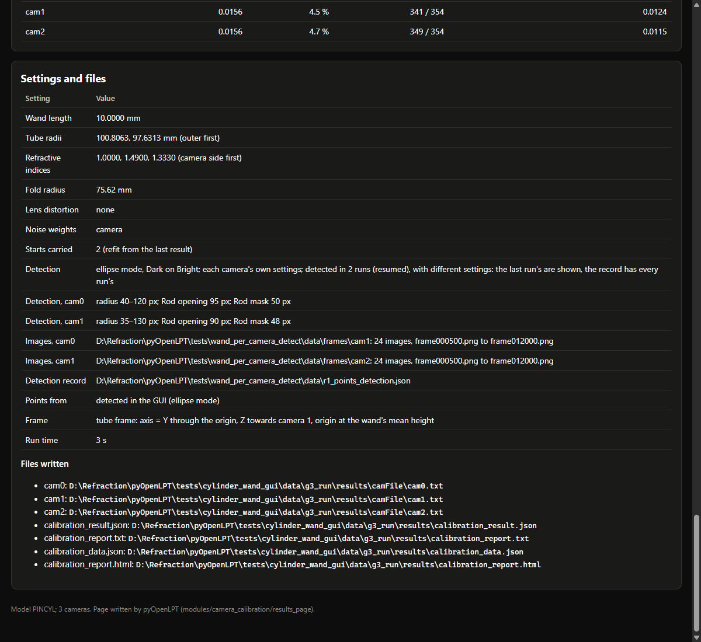

# Report: the detection record, on the results page and for reproduction (13 Oct 2026)

**Your message:** "i think it is a good idea to record the detection settings on the results page and save it for
reproduction"

**Then:** "go ahead. i think c is not necessary at this point".

**Plan:** `2026-10-13-plan-record.md`. Its section 6 records your answer and one change to the check.

**In short:**
- **Every detection is recorded** beside its points: `wand_points.csv` → `wand_points_detection.json`. The record
  holds the mode, the Wand Type, and each camera's settings exactly as its detector got them, and its images.
- **The record travels with the points:**
  - Load Wand Points reads it back;
  - the tube and flat-window calibrations save it in `calibration_result.json`;
  - every results page lists it.
- **The check** passed 12 of 12.
- **Nothing is committed.**

## 1. What changed

| File | Change |
|---|---|
| `wand_calibration/wand_calibrator.py` | `detection_record_path`, `save_detection_record` (a resume adds to the runs), `write_detection_record` and `load_detection_record`. No Qt. |
| `view.py` | **`_wand_detection_record()`:** one run's entry, built through `camera_detect_settings`, so it holds exactly what the detection tasks get. **Where it is used:** Process All Frames / Resume writes it when it starts; Export Data and the rescue export copy it beside their file; Load Wand Points reads it, so the detection mode is known again; the three calibrations pass it on (`detection=`). |
| `curved_calibration/cylinder_wand_gui.py`, `plate_wand_gui.py` | `Job.detection`, saved in `settings()`, and so in `calibration_result.json` under `gui.settings.detection`. |
| `results_page/page.py` | `_detection_rows`: the settings table's Detection rows, for all three models. A report without a record keeps its one Detection row, as before. |
| `WAND_CALIBRATION_USER_GUIDE.md` and `.html` | §3.1 step 5: the record; §6.5: where it is kept. |
| `tests/cylinder_wand/README.md`, `tests/plate_wand/README.md` | The 13 Oct entries. |

## 2. The record

**One entry per detection run** (a resumed file has two or more). Each entry holds:
- the time, and whether it resumed an earlier file;
- the mode and the Wand Type;
- whether the settings were each camera's own or shared;
- for each camera with images: R min, R max, the Sensitivity, and in the ellipse mode the Rod opening, Rod mask and
  overlap guard. These are the values its tasks got: with shared settings and pixel sizes, the scaled values to the
  last bit (40 × 20/13.5 = 59.25925925925925 px), with the factor and the pixel size beside them;
- the camera's images: folder, first and last file, and count.

**Reproducing a detection:** type each camera's values into the table under "Different settings for each camera",
and load the same images.

**On the results page,** in "Settings and files":
- **Detection:** the mode, the Wand Type, and how the settings were set. For a file detected in several runs it says
  whether they used the same settings. When they did not, the last run's are shown, and the record has every run's.
- **Detection, cam<id>:** that camera's values; the Sensitivity only in modes that use it.
- **Images, cam<id>:** the camera's images.
- **Detection record:** the record's path.



*G3's saved tube result shown with R2's record. Camera 1's last run had R max 130 px.*

## 3. The check (`r_record.py`): 12 of 12 passed

**The setup:**
- **The window:** the GUI's main window on the native platform, placed off the screen.
- **The frames:** 24 frames of T2 (500 to 12,000, every 500; cameras 0 and 1), copied once from X: into
  `data/frames/`.
- **The settings:** ellipse mode, the shared settings T2's.
- **The dialogs** are answered by their titles.

**R1, Process All Frames writes the record:**
- **Each camera's own settings** (camera 1: 35–125 px, opening 90 px, mask 48 px): the record beside
  `r1_points.csv` holds exactly the table's values, the mode, the Wand Type and both cameras' images. The run paired
  3 of the 24 frames, enough for the record's checks; a calibration needs hundreds.
- **Shared settings with pixel sizes of 20 and 13.5 µm:** camera 1's entry holds 59.25925925925925–
  177.77777777777777 px, opening 141 px and mask 74.07407407407408 px, with its factor 20/13.5 and pixel size 13.5 µm.
  These are the shared values times the factor, to the last bit.

**R2, a resume** of `r1_points.csv`, with camera 1's R max changed to 130 px:
- the record keeps R1's run and adds its own (resumed);
- Export Data wrote `r2_export_detection.json` beside the copy, with the same runs.

**R3, Load Wand Points:**
- a file with a record gives the mode (ellipse) and both runs back;
- a copy without one stays "unknown", as before.

**R4, the calibration's Job:**
- **The tube Job** carries the record, and detect_mode "ellipse", into its settings. It was captured before its
  worker started: its frame-count check was skipped, because 24 frames are too few for the fit's start, and no fit
  was run.
- **The flat-window Job's** settings carry it too.

**R5, the results page:**
- **The rows:** `report_from_cylinder` (G3's saved result with R2's record) gives the Detection rows. Its head reads
  "ellipse mode, Dark on Bright; each camera's own settings; detected in 2 runs (resumed), with different settings:
  …", then:
  - "Detection, cam0: radius 40–120 px; Rod opening 95 px; Rod mask 50 px";
  - "Detection, cam1: radius 35–130 px; Rod opening 90 px; Rod mask 48 px";
  - the two Images rows and the record's path.
- **The other models:** the flat-window (G8) and pinhole (W9's rig) reports give the same rows.
- **Without a record:** G3's result keeps its single Detection row.
- **In QtWebEngine:** the page draws with no console message. I looked at the picture above.

**One change from the plan:** the check uses 24 frames, not W1's six. Six frames paired nothing, because the pairing
needs 10 detections per camera to learn the two balls' sizes. With no pairs there was nothing to export or load, so
R2's export, R3 and R4 failed, and the script then crashed (`r_record_console.txt` of that run was overwritten).

## 4. Limits

- **Points detected before today** have no record. They behave as before: "Detection mode unknown".
- **Not recorded:** frames deleted later (the error table's Del) and filter thresholds change which points the
  calibration uses, but they are not detection settings. The calibration's own settings record which frames it used
  (`frame_ids`).
- **Not done:** (b), the guide's screenshot of the panel, and (c), applying a record to the panel.

## 5. Reproducing

```
python r_record.py       # needs run 20261006/T2 on X: the first time (it copies 24 frames into data/frames/)
```

Run it with the `refract` environment's interpreter. Its points, records and page go into `data/` (not tracked).

## 6. Files here

| File | What |
|---|---|
| `2026-10-13-plan-record.md` | the plan, with your answer (section 6) |
| `r_record.py`, `r_record_out.txt`, `r_record.json`, `r_record_console.txt` | the check and its results |
| `r_record_page_settings.png` | the results page's settings table with a record |
