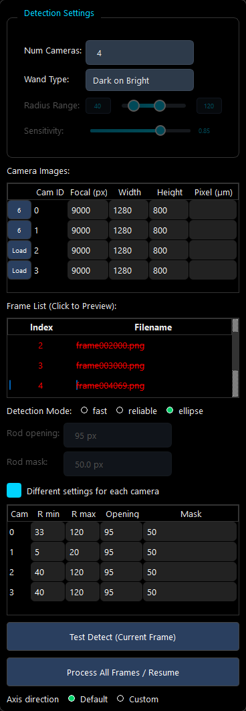
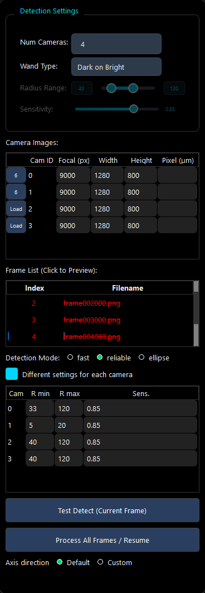

# Report: detection settings per camera in the wand tab (13 Oct 2026)

**Your question:** "i still cannot set object parameters for each camera? for example, the wand opening, wand mask,
radius range? i think that is important if my cameras have different resolutions?"

**Then:** "go ahead. by the way for ellipse, do we need sensitivity?"

**Plan:** `2026-10-13-plan.md`. Its section 6 records your answer.

**In short:**
- **The new box.** The wand tab's Point Detection panel has a box, "Different settings for each camera". Ticked, a
  table gives every camera its own R min, R max, Sensitivity, Rod opening and Rod mask, in its own pixels.
- **Where it applies:** Test Detect, Process All Frames and the axis points' Detect use the table, for every model.
- **The ellipse mode does not use the Sensitivity,** so the column and the shared slider show only where it is used.
- **Nothing changes until you edit a row.**
- **The check** passed 17 of 17 in the GUI's own window on T2 frames.
- **Nothing is committed.**

## 1. What changed

| File | Change |
|---|---|
| `modules/camera_calibration/wand_calibration/wand_calibrator.py` | **New `camera_detect_settings(...)`:** one camera's (min radius, max radius, sensitivity, ellipse options), from its own row if it has one, else from the shared settings through `scale_detect_settings`, as before. **Its callers:** the two places that build detection tasks (`detect_wand_points_generator`, `detect_single_frame`). **A new optional argument, `cam_settings`,** taken by those two and by both detection workers. |
| `modules/camera_calibration/view.py` (the wand tab in use) | **The box and the table**, just above Test Detect. **The helpers** `_wand_cam_settings`, `_update_wand_percam_table`, `_fill_wand_percam_rows`, `_refresh_wand_detect_state` and `_dim_unused`. **The three detection calls** pass `cam_settings`. **A check** stops a row whose R min is not below its R max. **The Pixel (µm) column's tooltip.** |
| `WAND_CALIBRATION_USER_GUIDE.md` and `.html` | §3.1 step 3 and §3.2: the new row, the Sensitivity row (greyed in the ellipse mode) and the Pixel row (its factor applies to shared settings only). |
| `tests/cylinder_wand/README.md`, `tests/plate_wand/README.md` | A progress-log entry. |
| `.gitignore` | A negation that tracks this folder without its `data/`. |

**The HTML guide was behind its source.** The rebuild also brought in earlier changes to the `.md` that had never
been built: the Pixel (µm) row, the Phantom-header note on Load, and the Radius Range text.

## 2. How it works

- **The table:** Cam (the camera table's Cam ID), R min, R max, Sens., Opening, Mask.
  - **Which columns show:** Sens. where the Sensitivity is used: fast, reliable, or any mode with the custom axis
    direction, whose Detect always runs "reliable". Opening and Mask show in the ellipse mode only.
  - **The radius limit:** each row's radii are limited to a quarter of its own camera's shorter side once its images
    are loaded, as the shared slider is.
- **Ticking the box** fills the rows from the shared settings, times each camera's Pixel factor when the Pixel column
  is set.
  - **The cells show them to 0.01 px,** but the detection uses the exact values until a cell is edited (40 × 20 / 13.5
    = 59.259259… px, not 59.26).
  - **Why that matters:** fast's fallback and reliable (OpenLPT's C++ circle finder) moved a point by 0.51 px, and
    changed a point count in one of six frames, when the radius bounds moved by 0.002 px (a scratch measurement on
    camera 2's six T2 frames). Bounds kept to 1e-6 px moved nothing by more than 2.5e-7 px.
- **While the box is ticked:**
  - the shared Radius Range, Sensitivity, Rod opening and Rod mask are disabled and faded, with their labels, because
    their own styles draw no disabled look;
  - the Pixel factor is not applied, so each row is in its own camera's pixels.
- **Unticking** returns to the shared settings. The rows are kept, and ticking again does not overwrite rows you
  edited.
- **Num Cameras:** the cameras that remain keep their rows, and a new camera's row starts from the shared settings.
- **The console line** of a detection lists each camera's values.



*Ellipse mode, box ticked: the shared settings faded; each camera's R min, R max, Opening and Mask (rows 0 and 1 as
the check left them).*



*Reliable mode: the Sens. column instead of Opening and Mask.*

## 3. The check (`k_per_camera.py`): 17 of 17 passed

**The setup:**
- **The window:** the GUI's main window on the native platform, placed off the screen.
- **The frames:** the six T2 frames that W1 copied (`tests/wand_gui_fixes/data/w1/dark/`, cameras 0 and 1).
- **The shared settings:** T2's (radius 40–120 px, opening 95 px, mask 50 px).

**K1, nothing changes:** Test Detect on frame 4069 gives the same points to the bit with the box unticked and with
it ticked (rows as filled).
- In the fast, reliable and ellipse modes;
- without pixel sizes, and with 20 and 13.5 µm (camera 1's rows then 59.26–177.78 px, opening 141, mask 74.07).
- The first run failed in fast and reliable with pixel sizes, because the rows then held the values to 0.01 px. Hence
  the exact values of section 2.

**K2, each camera gets its own values** (ellipse; camera 1's row 5–20 px, below its balls):
- **Test Detect:** camera 1 finds none of its balls. Camera 0 gives its points of K1 to the bit.
- **A row with R min above R max** stops Test Detect with a warning.
- **Process All Frames,** through the GUI's own path with its dialogs answered, on the six frames:
  - camera 0's 7 detections are those of a run with the shared settings;
  - camera 1 has none, where the shared run had 11;
  - the GUI then reported "No Wand Points", as it should with one camera blind.
  - **The first run failed this check on the test's own comparison.** It compared the file's rows in their written
    order, which follows the order in which the parallel workers finish. The rows are now sorted.
- **The first run's output files were overwritten by the reruns.** Its three failures were:
  - K1 fast and reliable with pixel sizes;
  - this row order.

  All three are described here.

**K3, the panel:**
- **Num Cameras 2 → 3 → 2:** the rows are kept, and the new one comes from the shared settings.
- **The columns follow the mode and the axis direction.**
- **The shared settings** are disabled while the box is ticked. The Sensitivity is also disabled in the ellipse mode
  without the custom axis.
- **No horizontal scroll bar** at 1500 × 900 and 1200 × 700, with four cameras and the box ticked (the content's
  minimum width is 336 px in a 358 px viewport).
- **The pictures above were looked at,** and two faults were fixed:
  - the disabled shared settings looked active (now faded);
  - the Opening header was cut to "Openinc" (its column is now wider).

## 4. Not done, and limits

- **Options (a) and (b) were not done:** the results page recording the detection settings, and a new guide
  screenshot of the panel.
- **Not saved between sessions:** the settings, shared or per camera, are not kept when the GUI closes, as before.
- **Not rerun:** the existing GUI tests and pytest, as for the other GUI changes. K1 shows that with the box off, the
  detection receives exactly what it did.

## 5. Reproducing

```
python k_per_camera.py      # needs tests/wand_gui_fixes/data/w1/ (python ../wand_gui_fixes/w1_bright_balls.py writes it)
```

Run it with the `refract` environment's interpreter. Its Process All Frames files go into `data/`, which is not
tracked.

## 6. Files here

| File | What |
|---|---|
| `2026-10-13-plan.md` | the plan, with your answer (section 6) |
| `k_per_camera.py`, `k_per_camera_out.txt`, `k_per_camera.json`, `k_per_camera_console.txt` | the check and its results |
| `k_per_camera_panel_ellipse.png`, `k_per_camera_panel_reliable.png` | the panel with the box ticked |
| `data/` (not tracked) | the Process All Frames files of K2 |
