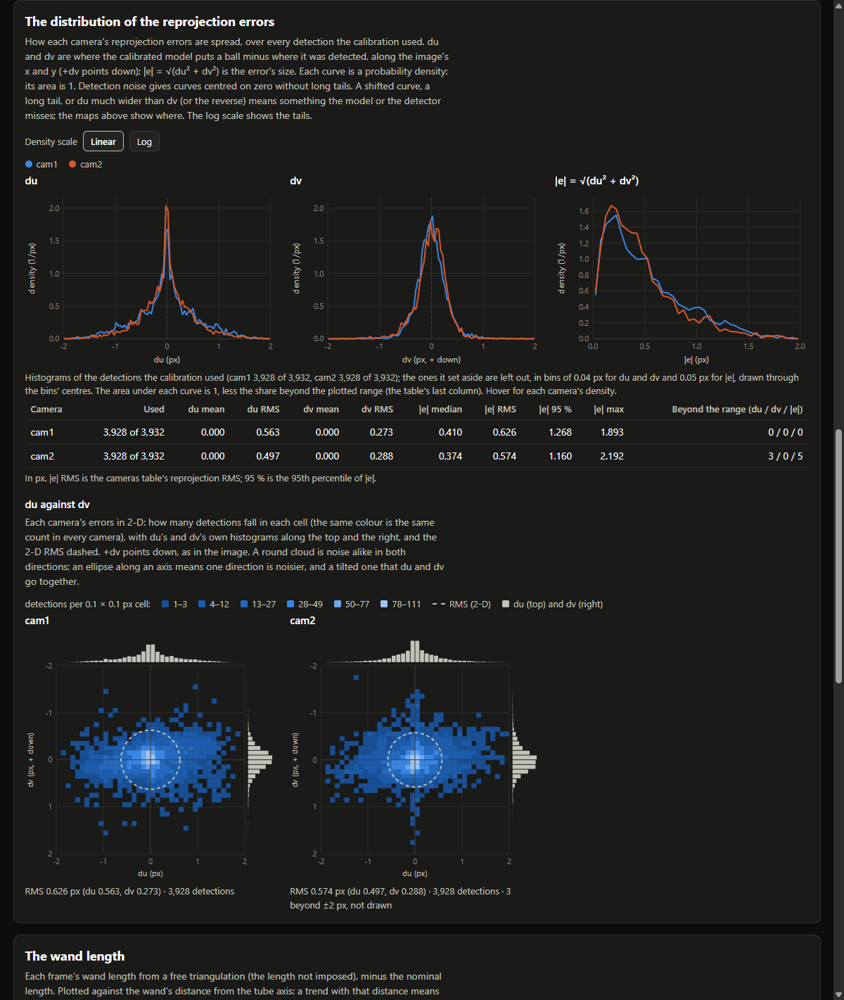
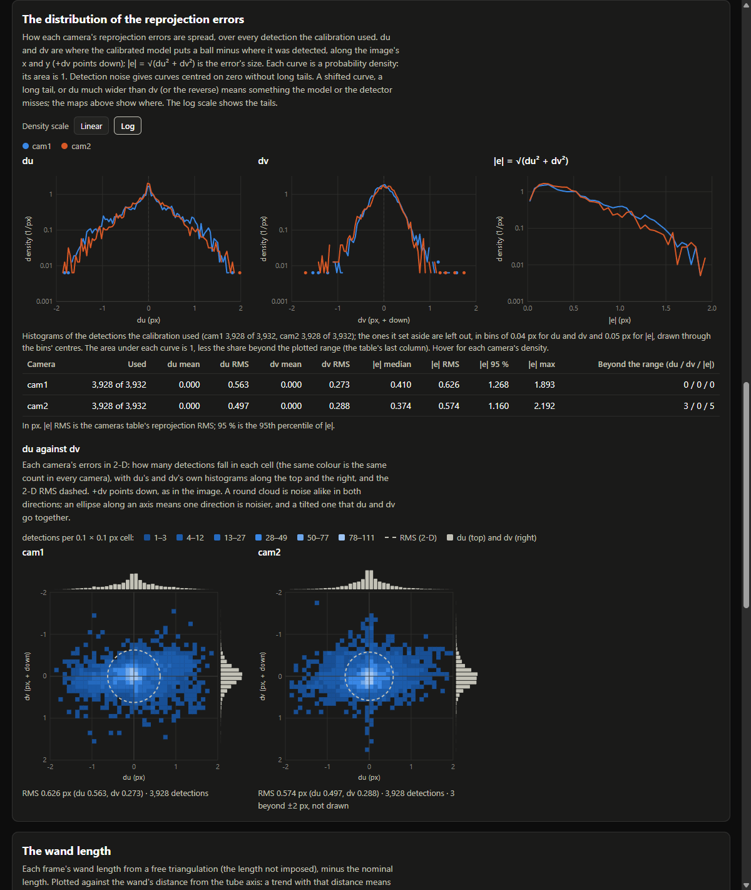
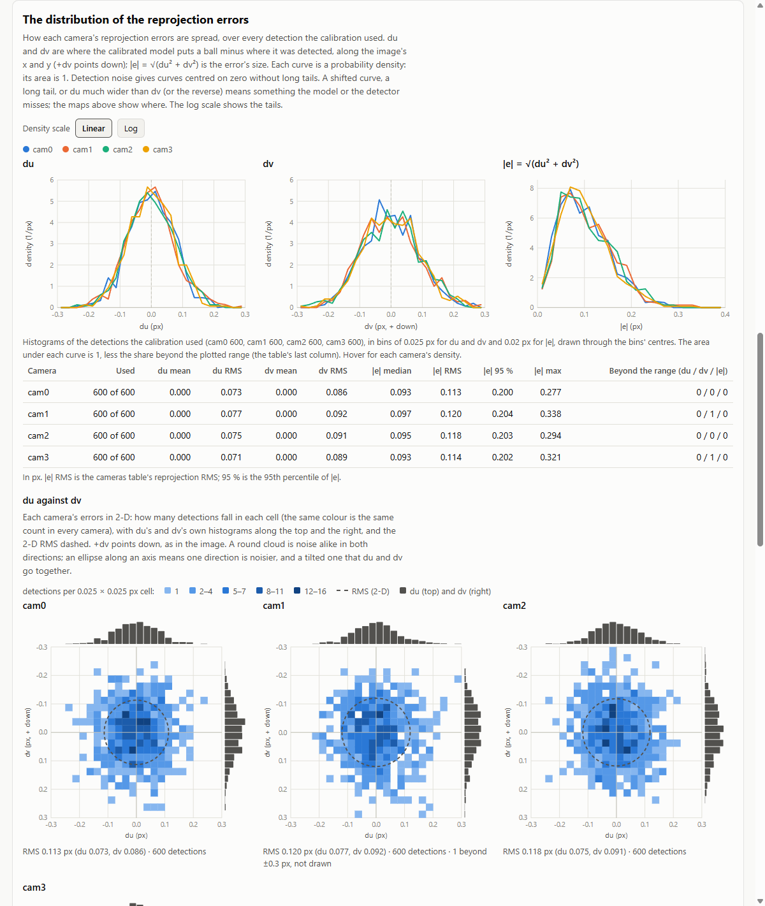

# Report: the reprojection errors' distributions on the GUI's results page (7 Oct 2026)

**Your request:** "for the gui, please add 2d projection error pdf for your wand calibration reports: du, dv, 2d
magnitude".

**Then:** "do the optional a,b . no need to do more tests because we are working on the gui improvement instead of
algorithm change".

**Plan:** `2026-10-07-plan.md`. Its section 5 records that decision.

**In short:**
- **The new section.** Every results page the GUI writes now has "The distribution of the reprojection errors", for
  the Pinhole, Pinhole + flat windows and Pinhole + cylinder models. It holds:
  - three probability-density charts per camera (du, dv and |e| = √(du² + dv²)), with a Linear / Log switch and a
    table of statistics;
  - (a) each camera's du-against-dv chart.
- **(b)** The T0 and T2 pages on X: are rendered again with the new section; nothing else on them changed.
- **The check** passed 34 of 34, on six pages, and I looked at the screenshots.
- **Nothing is committed.**

## 1. What changed

| File | Change |
|---|---|
| `modules/camera_calibration/results_page/page.py` | **New `_error_pdf`:** the range, bins, counts and statistics. **New helpers:** `_errors_from_data`, `_nice_up` and `_round_width`, and the constants `ERR_COVER`, `ERR_BINS` and `ERR_CELLS`. **Each adapter** (`report_from_cylinder`, `report_from_plate`, `report_from_pinhole`) adds one key to its report, `error_pdf`, and the docstring's schema lists it. Nothing else changed. |
| `modules/camera_calibration/results_page/template.html` | **The new section,** after "How well each camera fits". It is drawn by `redraw()`, so it follows the light/dark switch, and it is skipped when a report has no `error_pdf`. **CSS:** the pressed toggle, two legend swatches, and the grid of the du-against-dv charts (at most 3 a row). |
| `WAND_CALIBRATION_USER_GUIDE.md` and `.html` | §6.3 lists the new section. §6.4 has a bullet on reading it. The HTML was rebuilt with `make_user_guide.py html`. |
| `.gitignore` | A negation that tracks this folder without its `data/`, the pages it renders. |
| On X:, T0 and T2 `Results\` | `calibration_report.html` rendered again (option b). The README's row for it says so. |

**Not touched:**
- the calibrations, camFiles and results;
- `view.py` and the rest of the GUI. The Report tab shows the page that the calibration writes.

## 2. The section



*T2's page (real tube run, two cameras), dark as in the GUI. du is about twice as wide as dv in both cameras.*

**Its parts, from the top:**
- **A Linear / Log switch** and the camera legend.
- **Three charts:** du, dv and |e|.
  - One line per camera, in its colour on the rest of the page.
  - The y axis is probability density (1/px), so each curve's area is 1, less the share beyond the plotted range.
  - du and dv share both axes. Zero is dashed.
  - Hover gives a crosshair and each camera's density and count in that bin.
- **A caption:** the detections used per camera, and the bin widths.
- **A table per camera:**
  - used / all detections;
  - du and dv: mean and RMS;
  - |e|: median, RMS (equal to the cameras table's RMS), 95th percentile and maximum;
  - how many fall beyond the range, for du, dv and |e|.
- **(a) du against dv**, one chart per camera:
  - the counts per cell, on a square-root scale in six steps of one blue ramp, shared by every camera, so the same
    colour means the same count;
  - du's and dv's histograms along the top and the right;
  - the 2-D RMS as a dashed circle;
  - +dv drawn downward, as in the image;
  - hover gives a cell's count;
  - this is the T0/T2 case pages' chart.

**How the numbers are made** (in Python, `_error_pdf`):
- **Which detections:** every detection that the fit used, not the at most 2,500 per camera that the residual maps
  draw. For the tube and the flat windows, these are the active detections that project. For the pinhole model,
  they are all of its page's triangulated detections.
- **What is stored:** the counts per bin, as integers. The page divides them by n × the bin width.
- **The range:** du and dv share ±R. R is the smallest round number (1, 1.2, 1.5, 2, 2.5, 3, 4, 5, 6 or 8 × 10^k)
  that holds every camera's 99.5th percentile of |du| and |dv|. |e| runs from 0 to the same rule applied to |e|.
- **The bin width:** a round width (1, 2, 2.5, 4 or 5 × 10^k) that splits the range exactly into 20 to 150 bins. It
  is the one nearest the Freedman–Diaconis width (2 IQR n^(−1/3)) of the narrowest camera.
- **The du-against-dv cells:** 16 to 40 per side, from the smallest camera's n.

| Run | du, dv | \|e\| | du against dv |
|---|---|---|---|
| T2 (real tube, 2 cameras, 3,928 detections each) | ±2 px, 100 bins of 0.04 px | 0–2 px, 40 bins of 0.05 px | 40 cells of 0.1 px |
| T0 (real tube, 2 cameras, 3,032 each) | ±1.5 px, 75 bins of 0.04 px | 0–2 px, 50 bins of 0.04 px | 30 cells of 0.1 px |
| G3 (synthetic tube, 3 cameras, ~345 each) | ±0.05 px, 40 bins of 0.0025 px | 0–0.06 px, 24 bins | 20 cells of 0.005 px |
| G8 (synthetic flat windows, 4 cameras, 600 each) | ±0.3 px, 24 bins of 0.025 px | 0–0.4 px, 20 bins | 24 cells of 0.025 px |
| Pinhole (synthetic, 3 cameras, 600 each) | ±0.25 px, 25 bins of 0.02 px | 0–0.3 px, 30 bins | 20 cells of 0.025 px |

## 3. The check (`render_check.py`): 34 of 34 passed

**The pages:**
- **Synthetic:**
  - G3 (tube) and G8 (flat windows), the saved runs of `tests/cylinder_wand_gui`;
  - a 3-camera pinhole rig (W9's), with its true cameras.
- **Real:** T0 and T2, read from X:.
- **"old":** G3's report without `error_pdf`. This is what a GUI started before the change writes.

Each page was rendered into `data/` and loaded in QtWebEngine, the Report tab's engine (the native platform, with the
window off the screen).

**The numbers:** each camera's |e| RMS equals the cameras table's RMS to the five decimals printed, on every page.
For example:
- T2: cam1 0.62588 px, cam2 0.57402 px;
- G8: cam0 0.11301 px.

`render_check_out.txt` has every camera.

**In QtWebEngine:**
- **Every page** loads, and its script finishes.
- **The section** has 3 charts plus one du-against-dv chart per camera, with 3 curves per camera. The old page has
  no section.
- **Each page** has no console error and makes no request other than itself.
- **The dark and light themes** both apply.
- **Hover:** a pointer over the du chart shows the tooltip, e.g. on T2: "du 0.00 to 0.04 px / 1.68 /px cam1, 264
  detections / 1.96 /px cam2, 308 detections".
- **The Log switch** redraws the curves.
- **At 390 px wide,** nothing overflows.

**The screenshots** (`render_<page>_<theme>[_log].png`) were looked at, and two layout faults were fixed:
- **The du-against-dv charts grew** to half the page with two cameras, and would have filled it with one. Now there
  are at most three a row, each at least 300 px.
- **"2-D" broke at its hyphen** in the text. It now uses a non-breaking hyphen.

A note on reading the screenshots: the bright line at du = 0 in the first run's du charts was the check's own hover
crosshair. The rerun clears it.



*T2 on the log scale: du's tails reach ±2 px, dv's about ±1 px.*



*G8 (synthetic flat windows, four cameras), light theme. The du-against-dv charts sit three to a row.*

## 4. Option (b): the pages on X:

`rerender_x_pages.py` rebuilt each report from the run's `calibration_result.json` and `calibration_data.json`. It
compared that report with the one embedded in the page on X:.

| Run | Before (written) | Equal in every key but `error_pdf` | After | Read back |
|---|---|---|---|---|
| T0 | 384,835 bytes (6 Oct 23:09) | yes | 409,822 bytes | the report built |
| T2 | 393,713 bytes (6 Oct 18:04) | yes | 421,745 bytes | the report built |

Each Results folder's `README.md` has its `calibration_report.html` row updated, with each file's line ends kept.

**Not changed:**
- the overview pages (`wand_calibration_20261006_T0.html` and `_T2.html`), which already have their own 2-D chart;
- the camFiles and results.

## 5. What the charts show on the real runs

**du is wider than dv in both runs and both cameras:**

| Run, camera | du RMS (px) | dv RMS (px) |
|---|---|---|
| T2 cam1 | 0.563 | 0.273 |
| T2 cam2 | 0.497 | 0.288 |
| T0 cam1 | 0.429 | 0.257 |
| T0 cam2 | 0.353 | 0.257 |

- **The case pages** found the same. There, the rod hides part of each ball's outline along u, and each camera's
  image jitters sideways on its own (T0's T1 b and D5).
- **The means are zero** to 1e-4 px.

**The tails:** on the log scale du's tails reach about ±2 px, and dv's about ±1 px. Beyond the plotted range:
- T0 cam1: 8 detections in du (0.26 %);
- T2 cam2: 3 in du and 5 in |e|.

**T2's du has a sharp spike at zero**, in both cameras. It is in the data, not in the chart:
- **The counts:**
  - 89 of cam1's and 155 of cam2's detections have |du| < 0.005 px;
  - in cam2, the two 0.005-px bins beside zero hold 80 and 75 detections, against about 20 per bin at ±0.1 px.
- **They come in pairs:** where cam1's |du| < 0.005 px, the same ball's |du| in cam2 has a median of 0.011 px,
  against 0.24 px over all.
- **Not the wand's tilt:** those frames' wands are about as vertical as the rest (median vertical component 0.30,
  against 0.24 for all frames).
- **Not looked into further** (scratch checks, not kept).

## 6. Not done, and limits

- **Tests H1–H6 were not run** (your call):
  - no independent recomputation of the counts;
  - no edge cases (a camera without detections, all errors zero);
  - no rerun of `tests/cylinder_wand_gui`'s GUI tests;
  - no pytest.

  The only numeric check is the |e| RMS against the cameras table.
- **The GUI itself was not started.** The Report tab shows the same file that was checked here.
- **A GUI that was already open** writes pages without the new section until it is restarted. Its Python modules
  are loaded once, and the template then finds no `error_pdf`, so it leaves the section out without an error.
- **Pages written before today** keep their old template. Only T0 and T2 on X: were rendered again.

## 7. Reproducing

```
python render_check.py                 # needs X: (T0, T2) and tests/cylinder_wand_gui/data/g3_run, g8_run
python rerender_x_pages.py             # the comparison only; --write writes the two pages on X:
```

Run them with the `refract` environment's interpreter. The pages that `render_check.py` writes go into `data/`,
which is not tracked.

## 8. Files here

| File | What |
|---|---|
| `2026-10-07-plan.md` | the plan, with your decision (section 5) |
| `render_check.py`, `render_check_out.txt`, `render_check.json`, `render_check_console.txt` | the check and its results |
| `render_<page>_<theme>.png`, `render_<page>_dark_log.png` | the section of each page, as checked (pages g3, g8, pinhole, t0, t2; `old` shows the residuals section, where the page ends without the new one) |
| `rerender_x_pages.py`, `rerender_x_pages_out.txt` | option (b): the comparison run, then the writing run |
| `data/` (not tracked) | the rendered pages |
